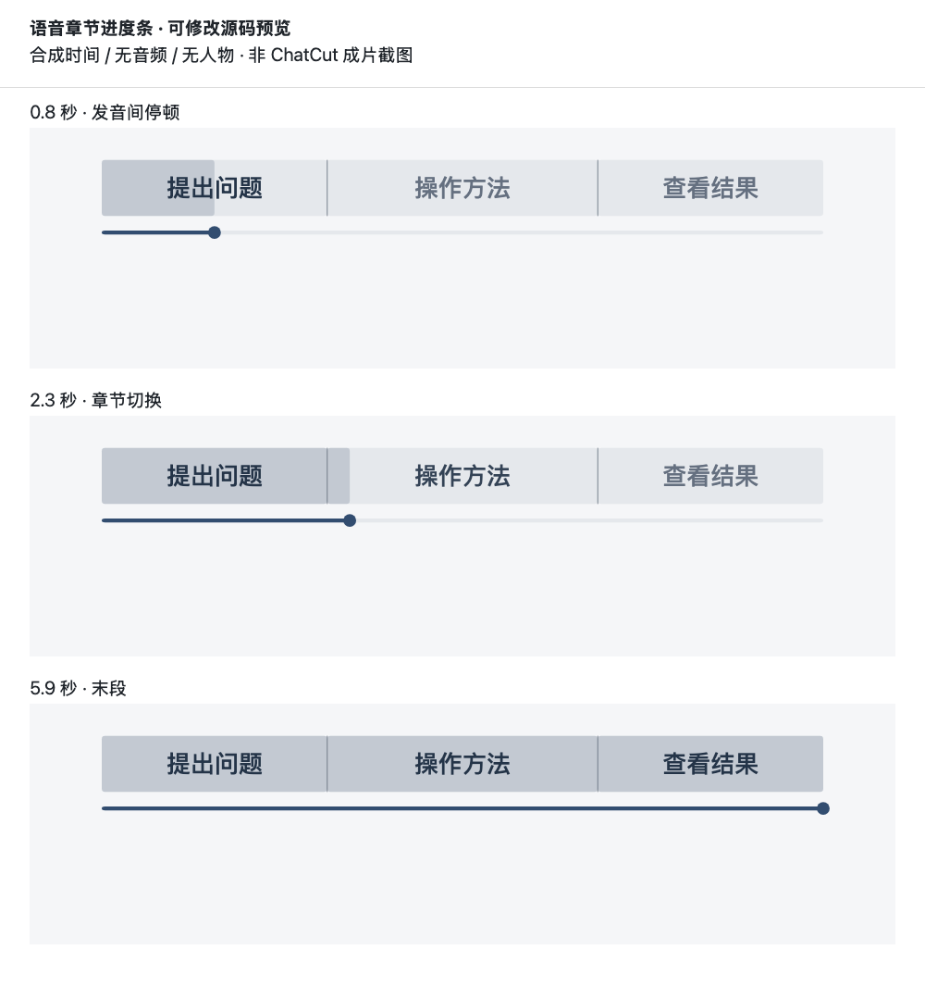
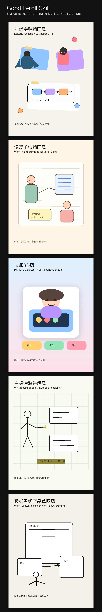

# 视频剪辑工作流组合包

**交付形态：GitHub Public 公开测试版。自有内容采用 MIT，版权署名为 belalee-ai；朋友环境的端到端出片尚未实测。**

给需要做口播、真实录屏和解释视频的人：先确认自己的说话与画面设置，再用 ChatCut 维护可编辑母版，按需要接入其他素材与动效工具。

## 它包含什么

- 11 个通用 Skill：主剪辑流程、口播、B-roll、动效选型、语音章节进度条、人物素材、手绘图示、新闻解释、封面、选帧、文字动效。
- 一份逐项确认的项目简报模板。生成前明确画幅、是否真人、人物位置大小、素材窗口与占比、字体风格/大小参考、字幕、素材风格、声音和交付规格。
- 基础 001–030 文字动效的共用源码和 ChatCut 载荷生成器；不包含整个图库网站。
- [语音进度条与人物陪伴](skills/speech-progress-overlay/SKILL.md)：章节有无、人物无/固定/跟随可独立选择，附可修改配置、确定性进度源码和浏览器预览生成器；人物与分层绑定由使用者自己的素材适配。
- 19 个可选第三方 Skill 的实际文件与各自 MIT 许可，另有 37 项独立安装入口；一个旧副本来源仍未确立。见 [能力与获取状态](skills/video-editing-workflow/references/toolbox.md) 和 [依赖数据](docs/dependencies.json)。

本包是工作流和部分组件源码，不是独立剪辑 App；不自带 ChatCut 服务、账号、额度、AI 模型、字体或完整渲染环境。图示/人物入口提供通用制作方法；进度条附通用源码与预览，不含历史专属人物、字体、配色或人物关节模板。浏览器预览不等于 ChatCut 已导入验证。

## Agent 与实际验证状态

| Agent/表面 | 文件安装方式 | 文件安装检查 | 客户端自动加载/触发 | ChatCut 整条制作 |
|---|---|---|---|---|
| Codex 本地 | 本包安装脚本或复制到其 Skill 目录 | 以[验证记录](docs/VERIFICATION.md)为准 | 尚未在新客户端会话验证 | 未在朋友环境实测 |
| Claude Code 本地 | 同包复制到其 Skill 目录 | 同上 | 未实测 | 未实测；需该宿主实际可用的 ChatCut 接入 |
| 其他 Agent、纯聊天/云端 | 需另查其 Skill 与工具接入方式 | 未测 | 未测 | 不承诺直接可用 |

安装目录依据当前 [Codex 官方文档](https://developers.openai.com/codex/skills/) 与 [Claude Code 官方文档](https://code.claude.com/docs/en/skills)。文件格式支持与实际视频功能是不同层级；请查看验证记录中的具体边界。

## 安装

仓库：[belalee-ai/video-editing-workflow-bundle](https://github.com/belalee-ai/video-editing-workflow-bundle)。这是公开仓库，任何人都可以查看、下载和安装。

下载仓库：

```sh
git clone https://github.com/belalee-ai/video-editing-workflow-bundle.git
cd video-editing-workflow-bundle
```

也可以在 GitHub 网页通过 Code → Download ZIP 下载并解压。收到完整文件夹后，让 AI 助手读取此 README，或进入本文件所在目录运行以下安装命令。不要把访问令牌放进聊天、安装请求或仓库文件。

可复制给助手：

> 请读取公开仓库 https://github.com/belalee-ai/video-editing-workflow-bundle 的 README，把 skills 下的随包 Skill 安装到当前 Agent 的正确目录。不要覆盖同名 Skill 或已有定制；发现冲突先列出。先安装 11 个通用 Skill；只有我选定时才安装随包可选 Skill，不自动联网安装其他扩展，不上传素材、不登录代办、不启动视频生成。完成后报告安装路径、客户端是否识别，以及还缺哪些制作工具。

需要 Python 3 的本地安装命令（任选当前使用的一个 Agent）：

```sh
python3 scripts/install.py --agent codex
```

```sh
python3 scripts/install.py --agent claude
```

查看随包可选 Skill（不安装、不联网）：

```sh
python3 scripts/install.py --list
```

选择随包扩展时明确列名，例如需要 B-roll 提示词和 GSAP 时间轴：

```sh
python3 scripts/install.py --agent codex \
  --include good-broll gsap-core gsap-timeline
```

Claude Code 将 `--agent codex` 换为 `--agent claude`。安装器只复制你选定的扩展，不自动安装其运行库、登录服务或启动生成。第三方原包里的旧目录示例不覆盖本 README 的安装方式。

项目级安装：在本包目录调用安装脚本，并将 `--target` 指向目标项目的 `.agents/skills`（Codex）或 `.claude/skills`（Claude Code）。使用实际绝对路径，不能把示意路径原样当安装目标。

脚本默认只复制 11 个通用 Skill；同名目标存在则整批停止，不覆盖。安装后按客户端要求重新加载/开启会话，并检查是否能识别 `video-editing-workflow`。识别失败时先检查实际目录、`SKILL.md` 与引用文件，不重复安装到多个目录造成重名。

## 第一次使用

在 Codex 调用 `$video-editing-workflow`；Claude Code 可用 `/video-editing-workflow`，也可以直接描述剪辑任务。不要把写在对话里的名称当成客户端已实际加载的证明。

先试无需云端写入的需求确认：

> 使用 video-editing-workflow。我想做一条录屏讲解视频。先读取我提供的稿件和素材，只整理已知设置并询问缺项。请确认说话风格、画幅、是否真人及位置、素材大小占比、字体风格和大小参考、字幕及素材风格；没有参考的项先给提案。此次只做到确认简报，不创建工程或生成素材。

确认后再说：

> 沿用已经确认的简报，用 ChatCut 剪第一版。先给实际画幅的布局样张，我确认后再做样例和整条；此次交付可编辑工程与预览。

如确实需要 MP4，在任务中明确要求导出，并提供规格。此前已明确的要求不重复询问。外部发布单独授权。

## 自定义怎样起作用

完整字段见 [需求确认](skills/video-editing-workflow/references/intake.md)；可直接填写 [简报模板](skills/video-editing-workflow/templates/brief.md)。

有参考时先实际查看，区分它负责字体、位置、人物还是材质；没有参考时先提供少量方案，经选择后记录尺寸与设置。没有真人、字幕或音乐可明确选“无”。同一项目已确认项沿用，局部改字不会要求重填全表。

人物和素材的空间占比、主画面类别的时长占比、视频画幅分别记录；字体按标题/字幕/强调字分开确认。使用者的项目资料和偏好只保存在其自己的项目中。

## 使用自己的进度条

安装组合包时，`speech-progress-overlay` 已包含在默认 11 个 Skill 中，无需额外安装原作者的两个人物/进度条包。

可直接对助手说：

> 用 speech-progress-overlay 给我的视频加进度条。先沿用当前简报，只询问缺少的设置：要不要章节文字、要不要人物、固定还是跟随、位置和大小、字体字号与参考、颜色底板和动作强度。使用我自己的素材；没有确定的项先给方案，等我选择。按实际口播词时间划分章节，先看布局和短样，再接整片。个人设置留在我的项目里。

不想带人物可以明确说“只要章节进度条，无人物”；只想改一项可以说“沿用已确认设置，只把字体改成我提供的字体，先给样张”。需要自己的小人抬手/摆腿时，另提供或确认分层形象，单张图片不会自动产生关节动作。

想先离线试布局，按[配置说明](skills/speech-progress-overlay/references/customization.md)用随包合成示例生成 HTML，浏览器打开后点击播放：

```sh
node skills/speech-progress-overlay/scripts/make-preview.cjs \
  skills/speech-progress-overlay/assets/example-config.json progress-preview.html
```

示例不含真实音频、人物或用户偏好；正式制作必须换成使用者已确认的配置及真实时间。预览文件留在其自己的项目，不自动上传。

下图是上述源码在浏览器中的真实预览截图，使用合成时间；用于查看章节状态，不代表已经完成 ChatCut 视频制作。



## 环境与权限

| 用途 | 需要什么 |
|---|---|
| 需求、稿件、语义分镜 | 能读取本地 Skill 与用户指定文件的 Agent；查时效事实需网络 |
| ChatCut 实际剪辑 | 当前宿主支持的 ChatCut 插件/连接器、用户自己的登录、可访问的目标项目与工具权限 |
| 字幕与精确动效 | 唯一音频、可用转写及真实时间戳；必要时人工关键点 |
| 文字载荷/进度条本地预览 | Node.js 20+；生成器仅用内置模块。目标 MG 仍需实际验证字体及运行支持 |
| 本地媒体检查 | 按需 ffmpeg/ffprobe 或等效工具，不能仅因检查工具存在声称能完整剪辑 |
| 可选生图、视频、配音、音乐或其他引擎 | 对应工具、依赖、账号/API、网络与用途许可；费用由服务决定，不含在本包中 |

原始素材、人物参考、字体与音乐由使用者提供或选择，并按用途检查。云端导入只处理本次明确允许的素材。API 凭据留在用户自己的安全配置中，不放入简报、分享包或截图。

## 常见问题

- **有 Skill 却没有编辑器工具**：安装 Skill 不会自动安装服务；先完成需求/分镜，确认宿主里的 ChatCut 接入。
- **缺字体或字形变了**：检查实际编辑器可用字族、字重、缺字；给替代样张，经确认后改，不能静默替换。
- **画面提前揭晓、后半段漂移**：回查唯一音频、词级节点和工程总长，不分别猜字幕与动画时间。
- **进度条没有本人小人**：本包不附人物；可选无人物，或提供自己的参考和允许使用的素材。
- **文字生成成功却没在时间线出现**：JSON 是载荷；还需通过当前 ChatCut MG 工具创建资产、放置实例并查看真实合成帧。
- **扩展来源待核实**：这部分不作为已安装能力承诺，不能随便找同名项目替代；基本流程仍可继续。

## 分享与许可

自有通用内容采用 [MIT License](LICENSE)，版权署名为 belalee-ai。仓库可见性已设置为 Public。第三方组件保留自己的许可证，详见 [第三方说明](docs/THIRD-PARTY.md)，不被主包许可重新覆盖。[onetake 原仓库](https://github.com/feitangyuan/onetake)有非商业使用限制；部分音频、字体或运行依赖也有单独条件。

当前按公开测试版分发。运行与安装检查见 [VERIFICATION.md](docs/VERIFICATION.md)；朋友环境的完整制作验证仍未完成。

下图是随包 `good-broll` 原包的风格说明图，用于理解可选方向；它不是本组合包的实拍剪辑截图或端到端出片证明，也不是你的默认风格。


